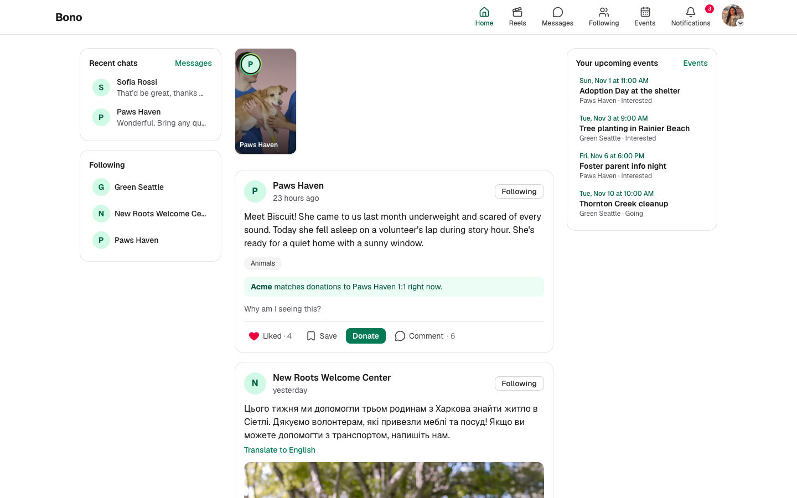
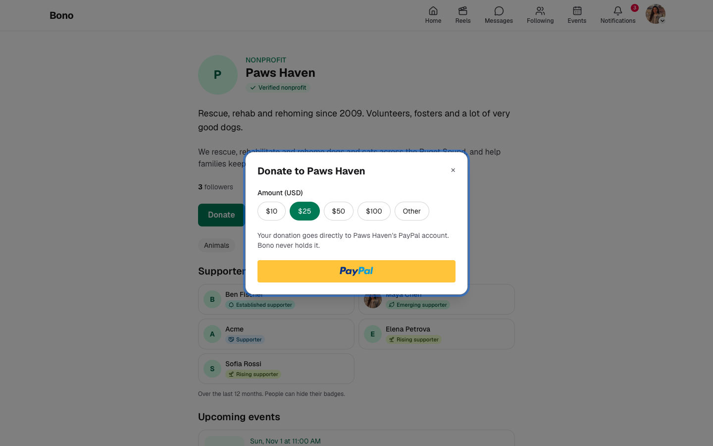
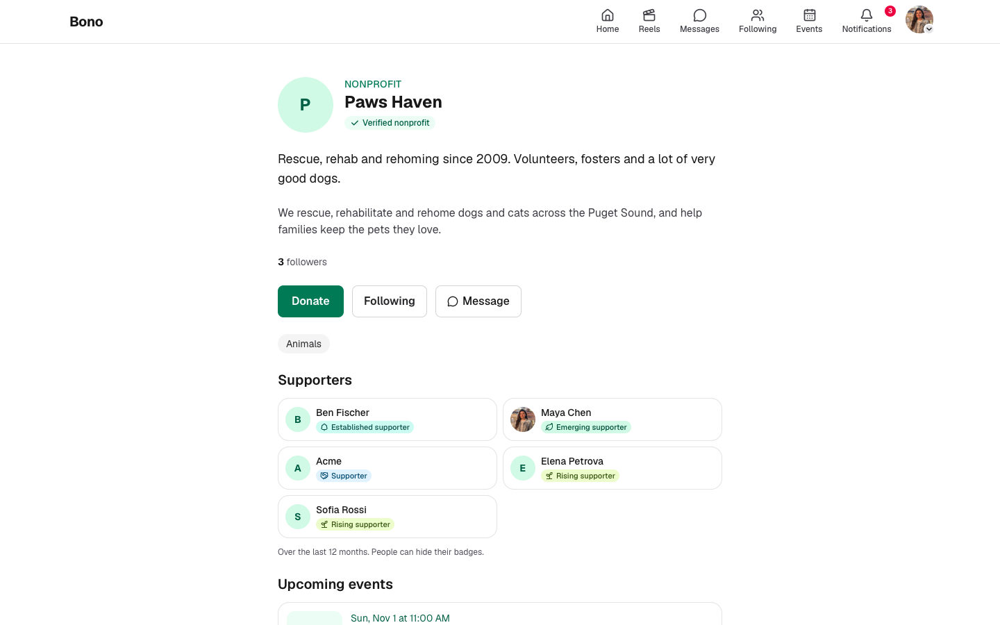
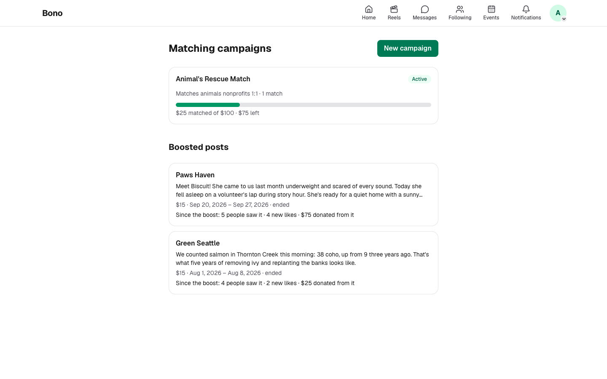
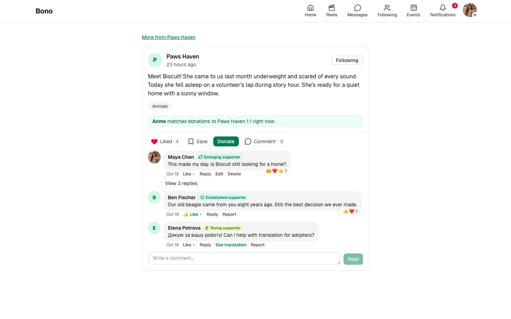
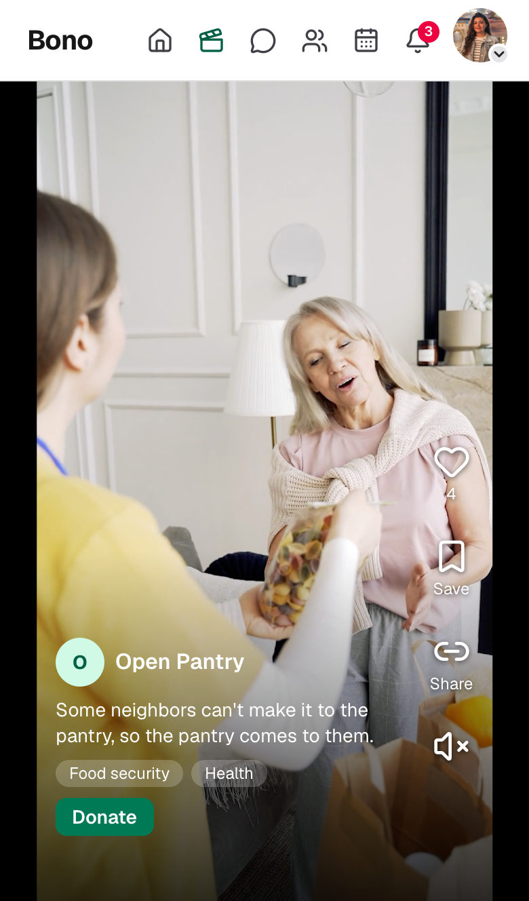
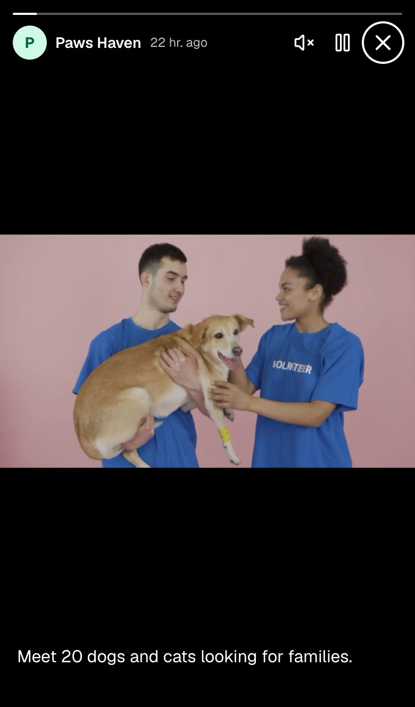
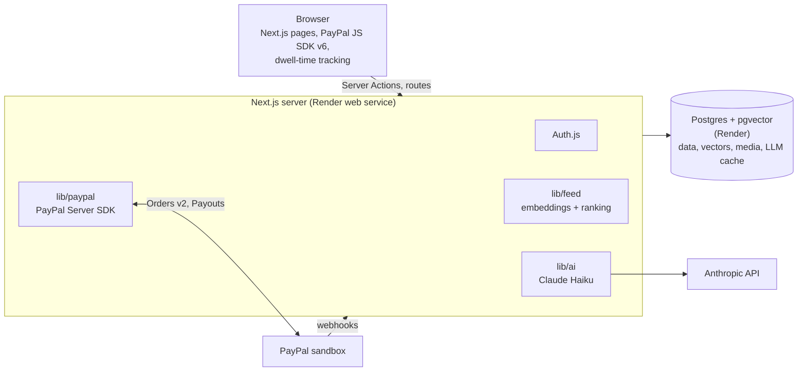

# Bono

**A social feed where nonprofits are the influencers.** Scroll guilt free: every post comes
from a verified charity, the feed learns which causes you care about, and when something moves
you, you donate in two taps with PayPal. The money goes **straight to the nonprofit's own
PayPal account**; Bono never holds it. Companies join as sponsors: they fund matching campaigns
and boost posts, always clearly labeled.

Built solo for the **PayPal AI Hackathon** with Claude Code and the APIMatic PayPal Context Plugin.

- **Live demo:** https://bono-h8b8.onrender.com (PayPal sandbox; the free server sleeps, so the
  first page can take ~30 s to wake up)
- **Demo video:** _coming soon_
- **Judge logins:** see [For judges](#for-judges)



## Why

Social feeds are built to keep us scrolling, and charities compete there with everything else,
paying for ads to be seen. Giving online, meanwhile, happens on a donation page you only reach
once you have already decided to give. Bono puts the two together: a feed with only nonprofit
content, ranked by what each person actually cares about, where giving is one tap from the story
that moved you.

- **Supporters** get a calm feed of causes they chose, see where their money goes, and earn
  public badges (tiers only, never amounts) for backing an organization over time.
- **Nonprofits** get an audience, donations paid directly to them, matching from sponsors, and
  a verified badge that means something (an EIN check against IRS data plus a PayPal fee).
- **Sponsors** fund matching pools and boosts, and see exactly what their money did.

## What you can do

| | |
|---|---|
|  | **Donate** from any post, reel, story or profile. PayPal Orders v2 with the nonprofit as the payee; the server sets and checks the amount. Laptops get the PayPal popup, phones a same-tab redirect. The thank-you says whether a sponsor matched the gift and the donor's new tier. |
|  | **Verified nonprofits.** An EIN check on demand against IRS records (via ProPublica), at least 6 months tax-exempt, then a $25 verification fee through PayPal. **Badges**: Rising, Emerging, Established and Champion supporters; Supporter, Partner and Champion Partner sponsors. |
|  | **Sponsors** create matching campaigns (cause or nonprofits, ratio, per-gift cap, pool, dates), fund the pool with PayPal, and Bono pays each match to the nonprofit with **PayPal Payouts**. Boosted posts rank higher and always show "Boosted by …". |
|  | **The social layer**: comments with replies and reactions, translation of posts and comments, "Why am I seeing this?", saved posts, one-to-one messages with photos, events with RSVPs, notifications, following. |

<p>
  
  &nbsp;
  
</p>

**Stories and reels** from verified nonprofits, made for phones: 24-hour stories with a viewer,
and a snap-scroll reels feed with muted autoplay and a Donate button on every video.

## How PayPal is used

All PayPal calls run on the server through the [PayPal Server SDK](https://github.com/apimatic/paypal-typescript-sdk)
(TypeScript, generated by APIMatic). The browser only ever receives the client ID. Everything
runs in the PayPal **sandbox**.

| Flow | PayPal APIs | Who gets paid |
|---|---|---|
| Donation | JS SDK v6 + Orders v2 (create, capture) with `purchase_units[].payee` | **The nonprofit**, directly |
| Verification fee | Orders v2; the capture must come from the nonprofit's own PayPal account | Bono (platform) |
| Sponsor pool / boost | Orders v2 | Bono (platform) |
| Sponsor match | **Payouts API**, one batch per match, `sender_batch_id` = match ID | The nonprofit |
| Confirmation | **Webhooks** with signature verification, stored and deduplicated by event ID | — |

- **Amounts are never trusted from the browser.** The server picks the payee and validates
  the amount when it creates the order, and records the amount PayPal actually captured.
- **One match per donation, ever.** `matches.donation_id` is unique and PayPal won't pay the
  same `sender_batch_id` twice. Payouts run after the response is sent (Next.js `after()`), so
  the donor never waits for them.
- **Phones** can't rely on popups, so they approve on PayPal in the same tab and come back to
  `/paypal/return`, where the server captures the order.
- Declines (`INSTRUMENT_DECLINED`) and errors get honest, specific messages.

## How AI is used

Everything except two short text jobs runs inside the app, with no paid AI service.

1. **Embeddings.** Each post (its text plus its cause tags) becomes a 384-number vector that
   captures its meaning, using the open-source `all-MiniLM-L6-v2` model running in the app
   ([transformers.js](https://huggingface.co/docs/transformers.js)). Vectors live in Postgres
   with pgvector. Non-English posts are embedded through their English translation, because
   the model reads English.
2. **Interests.** A new supporter starts at the average of the causes they picked. After that,
   their vector is recomputed from what they do:
   `normalize(1.0 × chosen causes + Σ weight × recency × engaged posts)`, with
   donate 1.0 > follow 0.6 > comment 0.5 > like 0.4 > long look (8 s+ on screen, measured in
   the browser) 0.2, and recency halving every 30 days
   ([`src/lib/feed/learn.ts`](src/lib/feed/learn.ts)).
3. **Ranking.** Every recent post gets
   `1.00 × relevance + 0.35 × freshness + 0.20 × followed + 0.15 × popularity + 0.30 × boosted + 0.08 × exploration`,
   where relevance is the cosine similarity between the person's vector and the post's; posts
   seen in the last 3 days move below "You're all caught up"
   ([`src/lib/feed/rank.ts`](src/lib/feed/rank.ts)).
4. **Claude Haiku** translates posts and comments on request and turns the real ranking reasons
   into a one-line "Why am I seeing this?". Every result is cached, so the same input never
   reaches the API twice ([`src/lib/ai/claude.ts`](src/lib/ai/claude.ts)). Comment languages
   are detected locally with franc.

## Architecture



- **Next.js 16** (App Router, Server Actions, TypeScript strict), Tailwind CSS, Auth.js.
- **Postgres + pgvector** with Drizzle; photos and short videos are stored in Postgres too
  (size-capped, resized with sharp, MP4 duration read from the file header, byte-range playback).
- **Render**: one web service and one Postgres database from [`render.yaml`](render.yaml).
  Migrations run on start; the embedding model is downloaded at build time.
- No background worker is needed: payouts and housekeeping run after responses, and expiring
  content (stories, reminders) is handled when it's read.

## Built with Claude Code + APIMatic Context Plugin

I built Bono with Claude Code. Every piece of PayPal work (orders, captures, Payouts, webhooks,
the phone redirect) went through the **APIMatic PayPal Context Plugin**: Claude looked up each
SDK operation, request field and error type in the SDK map instead of writing PayPal code from
memory, and kept a contract sheet in [`pay-pal-server-sdk-plan.md`](pay-pal-server-sdk-plan.md).

Sponsor tools: **PayPal** (payments), **APIMatic** (PayPal Server SDK + Context Plugin),
**Render** (hosting and Postgres), **Anthropic** (Claude Haiku, Claude Code).

## For judges

### Logins

_Judge sandbox logins will be listed here before submission._ Every demo account is fictional
and uses the reserved `bono.example` domain, for example `maya.chen@bono.example` (a supporter),
`paws-haven@bono.example` (a nonprofit) and `acme@bono.example` (a sponsor).

### Verifying a nonprofit you sign up yourself

Real nonprofits verify against IRS data. Every organization in this demo is fictional, so
Bono also has a **clearly labeled demo registry** of fictional EINs. They start with `00`, a
prefix the IRS never assigns, so they can never match a real organization. Ten of them are
spare entries for judges:

| EIN | Organization name to sign up with |
| --- | --- |
| 00-0000201 | Judge Test Nonprofit 1 |
| 00-0000202 | Judge Test Nonprofit 2 |
| 00-0000203 | Judge Test Nonprofit 3 |
| 00-0000204 | Judge Test Nonprofit 4 |
| 00-0000205 | Judge Test Nonprofit 5 |
| 00-0000206 | Judge Test Nonprofit 6 |
| 00-0000207 | Judge Test Nonprofit 7 |
| 00-0000208 | Judge Test Nonprofit 8 |
| 00-0000209 | Judge Test Nonprofit 9 |
| 00-0000210 | Judge Test Nonprofit 10 |
| 00-0000299 | Judge Test New Nonprofit *(tax-exempt for only ~2 months, so it shows the 6-month rule refusing verification)* |

1. Sign up as a **Nonprofit** and use one of the names above as the organization name.
   Each EIN can belong to one Bono account, so pick one nobody has taken yet.
2. On **Get verified**, enter the matching EIN. The page says the match came from the demo
   registry, not the IRS. Bono verifies organizations only after **6 months of tax-exempt
   status**; the demo entries have old enough (fictional) dates, except 00-0000299.
3. Pay the $25 verification fee (PayPal sandbox) **from the sandbox Business account you
   entered as your organization's PayPal email**. That is how Bono checks the account is
   yours. Logging in to PayPal with a different account doesn't verify the nonprofit.

### How the EIN check works

When a nonprofit asks to be verified, Bono looks its EIN up **on demand** in the IRS
records of tax-exempt organizations (the Exempt Organizations Business Master File,
which the IRS publishes monthly), through ProPublica's free
[Nonprofit Explorer API](https://projects.propublica.org/nonprofits/api). Nothing is
stored or reloaded, every check sees the latest published record, and every US state
is covered. Bono accepts 501(c)(3) charities whose donations are tax-deductible, under
a name consistent with the IRS record, and only once they have been **tax-exempt for
at least 6 months** (by their IRS ruling date). Until then, a nonprofit can still join and
take part like a supporter (follow, like, comment, RSVP, message), labeled "Not verified yet",
but it can't post or receive donations. The fictional demo nonprofits use the labeled demo
registry instead. Data: ProPublica Nonprofit Explorer and the IRS.

## Local setup (macOS)

Requirements: Node 24, Homebrew, a PayPal developer account with sandbox apps, and
(optionally) an Anthropic API key for translation.

```bash
# Postgres 17 + pgvector
brew install postgresql@17 pgvector
brew services start postgresql@17
/opt/homebrew/opt/postgresql@17/bin/createdb bono

# App
cp .env.example .env   # then fill in your own sandbox values
npm install
npm run db:migrate     # creates tables and enables pgvector
cp seed.example.json seed.local.json   # then add your sandbox Business emails
npm run seed           # demo nonprofits, sponsors, supporters and posts
npm run dev            # http://localhost:3000
```

### Demo data

`npm run seed` creates 6 fictional nonprofits, 2 fictional sponsors, 20 supporters
and 30 posts (some in Spanish and Ukrainian). Every organization and person in
it is invented. Five nonprofits start verified with fictional EINs from a clearly
labeled demo registry (prefix `00`, which the IRS never assigns); **Canvas Commons
starts unverified**, so the verification flow can be shown from the beginning.

So the supporter badges have something to show, the seed also writes a **fictional
giving history** for the demo supporters (and a few past boosts for the demo sponsors).
Those rows are marked `demo_seed`, have no PayPal payment behind them, and are replaced on
every run; donations made through PayPal sandbox are never touched.

Demo accounts log in with emails on the reserved `bono.example` domain (e.g.
`paws-haven@bono.example`, `acme@bono.example`, `maya.chen@bono.example`) and the
`demoPassword` from your `seed.local.json`.

Re-running the seed updates the demo accounts in place and **keeps their sandbox
history** (donations, verification fees). `npm run seed -- --reset` deletes the
demo accounts and everything they did, for a clean start. Accounts on any other
domain are never touched.

## Tests

- `npm test`: unit tests for the pure logic (feed ranking, the MP4 reader, EIN rules,
  badge tiers, notification wording, comment language detection, donation amounts), with
  Node's built-in test runner. No database needed.
- `npm run test:e2e`: browser tests of the main flows (comments, messages, events, saved
  posts, notifications, unverified nonprofits) with Playwright, against the local app and the
  seeded demo data. Run `npm run seed` first; the first time, also
  `npx playwright install chromium`. They log in with the demo password from
  `seed.local.json` and clean up after themselves.

## About this project

Bono was built from scratch during the hackathon's submission period. All organizations,
people, posts and logos in the demo are fictional.

## License

[MIT](LICENSE)
